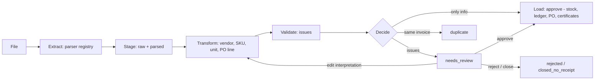

# Decisions

One principle: **when in doubt, a person decides.** An invoice is received on its own only when every
value is exact and unambiguous. There is no fuzzy matching and there are no tolerances.

## 1. Assumptions

- `data/` is the starting state and is never modified. One file holds one invoice, encoded as UTF-8.
- Stock is kept in each SKU's catalog unit, and vendor units are converted with exact factors (1 dwt =
  1.55517384 g, 1 troy oz = 31.1034768 g). Pieces never convert to a mass.
- A line that states no unit is taken in the SKU's unit. It is received automatically only when the PO
  price confirms that unit exactly; otherwise a person confirms it.
- Each file format has its own notation and vocabulary, and the samples show what they are:
  - **Thistlewood** writes `2,085.00` and puts the month first: its `11/03/2026` is the JSON's
    `2026-11-03`.
  - **Lucentara** writes `1.125,00` and puts the day first: `04/05/2026` comes after PO-2026-041 was
    ordered on 14 April. In its vocabulary `PZ` is a piece, `SPED` is shipping, and the `TOTALE` row
    holds the invoice total.
- The store's own currency is not given. Costs stay in the document's currency, with no FX conversion. A
  CSV without a currency column uses the vendor's currency.
- The vendor is the PO's vendor. Invoice numbers are unique per vendor (`inv_01` and `inv_04` are both
  10482), so a repeat means the same vendor and the same normalized invoice number.
- A MEMO (consignment) or a CREDIT_MEMO never adds owned stock. Freight is not spread into unit cost.
- There is a single staff role and no login yet.

## 2. Architecture overview

A **staged ETL pipeline with a human-in-the-loop gate**: clean invoices go straight to stock, and
exceptions wait until a person corrects the interpretation and decides.

- **Extract (`extraction/`).** Each format is a declarative layout registered with
  `@register(key, detect, priority)`. Detection is exact: every required field must be present and no
  unknown field may appear. A file no parser recognizes is logged as `ERROR` together with the field
  diff, and goes to a person.
- **Transform and validate (`matching.py`, `validation.py`).** The interpretation is derived from the
  parsed values and the reference data, and never overwrites a field a person edited. The checks only
  read data and produce issues.
- **Use cases (`services.py`).** Each use case runs in one transaction. The automatic path and the
  Approve button call the same `approve()`.
- **Thin edges.**
  - The DRF API translates HTTP into use cases.
  - The Next.js UI only displays data and sends actions; it never computes money.
  - `build_outcomes` runs the same ingest on a fresh database.

## 3. Data model

| Entity | Why |
| --- | --- |
| `Vendor`, `Product`, `VendorItem`, `PurchaseOrder`, `POLine` | Reference data from `data/`. Stock, `qty_received` and PO status change only through receiving. |
| `Invoice`, `InvoiceLine` | Three layers. **Raw:** the file and its sha256, and the text as sent; it never changes. **Parsed:** the values the format's parser read. **Interpretation:** vendor, PO, SKU, quantity in the SKU's unit, amount, certificates, plus `edited_fields`, status and notes. The review screen shows "as sent" next to "as understood". |
| `Issue` | Why the invoice needs a person. Recomputed on every validation. |
| `StockMovement`, `SerialUnit` | The ledger (opening stock plus one receipt per line), so `on_hand` always equals the sum of movements. One row per diamond certificate, with a unique number. |
| `AuditEvent` | Uploads, edits (before and after), approvals (with the discrepancies accepted), rejections. |

- The database enforces:
  - `on_hand >= 0` and costs `>= 0`;
  - unique vendor item codes, unique (PO, SKU) and unique certificate numbers;
  - unique (vendor, invoice number) among live invoices.
- Every decimal is `Decimal(15, 6)`. SQLite stores DECIMAL as REAL and keeps only 15 significant digits,
  so a value that would not round-trip exactly is refused rather than rounded.

## 4. What the system decides vs. what a person decides

The system receives on its own only when every issue is info. Decisions apply to the whole invoice
(approve, reject, or close a memo); there is no receipt of single lines.

| Kind | Effect | Examples |
| --- | --- | --- |
| terminal | Can never be received | MEMO, CREDIT_MEMO (`inv_05`, `inv_11`); an unrecognized file |
| hard | Fix the interpretation first | unmapped item code (`inv_06`), unknown unit `PR` (`inv_07`), missing certificate (`inv_09`), unreadable value, vendor not found, PO not found or of another vendor |
| soft | Approve only with explicit acceptance, which is audited | price ≠ PO (`inv_08`, `inv_10`), totals (`inv_02`), short shipment without a matching backorder (`inv_10`), over-receipt, not on the PO, no PO, currency ≠ PO, an unconfirmed unit |
| info | Context only | exact unit conversion, a backorder that explains the shortfall (`inv_04`), no totals in the file, a unit confirmed by the PO price |

- A person corrects only the system's interpretation; the vendor's data never changes.
  - In the header: vendor, PO, number, date, currency and totals.
  - On a line: type, SKU, quantity in the SKU's unit, amount and certificates.
- Each edit re-runs matching and validation and is audited. Approve validates again on current data.
- Text in the file is shown but never acted on. `inv_07` asks to be marked `RECEIVED_NGX` and is not.

## 5. Matching strategy

- **Format.** The layout whose fields match exactly. Values are read only in that layout's notation;
  anything else stays unread and a person enters it.
- **Vendor.** From the PO, by exact PO number. Without a PO, an exact name match; otherwise a person
  chooses.
- **SKU.** From the vendor item-code map, by exact (vendor, code). There are no suggestions by similar
  description.
- **Unit.** Exact aliases plus the format's own words, converted exactly to the SKU's unit. A missing
  unit means the SKU's unit, but only if the PO price confirms it. An unknown unit (`PR`) goes to a
  person.
- **PO line.** Found by (PO, SKU).
- **Price.** `amount == quantity in SKU unit × PO unit cost`, exactly. The check multiplies and never
  divides. For `inv_10`: 38.879346 g × 48.00 = 1866.208608, which is not 1866.25.
- **Quantity.** More than is still open on the PO line is a discrepancy. Less is only context when the
  vendor's backorder explains the difference exactly (`inv_04`: 120 + 80 = 200).

## 6. Failure modes

| What goes wrong | What happens |
| --- | --- |
| A vendor changes its format | No parser matches. The log gets `ERROR EXTRACTION_NO_PARSER` with the missing and unexpected fields. The file can only be rejected; the fix is one layout declaration. |
| A broken file, or one that is not UTF-8 | An `EXTRACTION_FAILED` or `DECODE_FAILED` alert, handled the same way |
| A value not in the format's notation | Not guessed. The raw text is kept and a person enters the value. |
| The same bytes again | The existing invoice is returned (sha256, checked under the write lock) |
| The same invoice in another file (`inv_03`) | Marked `duplicate` and not received. A partial unique constraint covers simultaneous uploads. |
| A renumbered duplicate | Caught by the over-receipt and certificate checks |
| A double click, or two reviewers at once | A row lock and a status check; the second request gets 409 |
| Data goes stale before approve | Approve validates again; if it refuses, the new issues are still saved |
| A failure halfway through a receipt | The whole transaction rolls back |
| A number too large to store exactly | Refused, never rounded |
| Instructions in the vendor's notes | Shown as text, never interpreted |

## 7. Security and data safety

- **Uploads.** Only `.json` and `.csv`, and the 1 MiB limit is checked before the file is read. Decoding
  is strict UTF-8. The file name is never used as a path, and the content is never executed.
- **File content is untrusted.** It is rendered as text and never drives logic. Logs record the file
  name, the sha256 and the reason a file was not read, never its data.
- **Integrity.** `Decimal` end to end, database constraints, atomic receipts with row locks, raw data
  that never changes, an audit trail and a stock ledger.
- **Access: no login yet, dev-only and deliberate.** Every action is recorded as `staff`. Until there is
  a login:
  - ports are published on `127.0.0.1` only;
  - approve, reject and close accept only JSON, so another website cannot trigger them without a CORS
    preflight, which is never granted;
  - the admin is view-only.

  Another site could still upload a file, but it gets the same checks as any other. A login with roles
  and CSRF protection is the next step.
- **Operations.**
  - Configuration comes from the environment, and `.env` is not committed.
  - Migrations are an explicit step. `data/` is mounted read-only.
  - The backend runs as the owner of the checkout, and the frontend as `node`.

## 8. Testing

- 124 pytest tests:
  - a golden run of the 12 samples that produces `outcomes.json`, deterministically;
  - every parser and notation, and the format-change alerts;
  - exact unit conversion;
  - duplicates and repeats;
  - the approval rules, including that approve validates again;
  - atomic rollback;
  - review flows (`inv_06`, `inv_07`, `inv_09`), edits and reverts;
  - the API contract;
  - the database constraints.
- pre-commit runs ruff, django-upgrade, a migrations check, eslint, prettier and `tsc`.
- An automated security and bug review found 9 bugs, all fixed and each covered by a regression test.
- Manual checks covered the full Docker cycle and the review flow through the UI.
- With more time I would add Playwright end-to-end tests, property-based tests for value parsing, and
  concurrency tests on Postgres.

## 9. What I cut and what I'd do next

The checks, atomic receipts, duplicates, the review screen and `outcomes.json` came first. Each item
below was cut on purpose:

- **Login and roles.** They add nothing to the receiving logic; the API is marked dev-only instead.
- **Accepting each discrepancy separately with a reason.** One explicit, audited acceptance is enough for
  now.
- **Reversing a receipt.** It needs reversal entries in the ledger, PO progress and certificates.
- **Memo stock and credit memos.** They are separate workflows; for now they are kept out of stock.
- **"Remember this mapping".** Changing reference data from a review needs its own approval.
- **Reprocessing a stored file after a parser fix.** Reject and upload again covers it.
- **Monitoring for alerts, landed cost and FX.** These depend on infrastructure and on accounting
  policy.
- **Postgres, async ingest, PDF and EDI.** The current volume does not need them.
- **Rejected rather than postponed:** receipt of single lines, fuzzy matching, and price tolerances
  unless the business defines them.

## 10. How I used AI tools

I used **Claude Code** for planning, code, tests and documentation, working in stages. I reviewed each
stage and committed it myself. Where I corrected or rejected its output:

- **"Correct" in the brief.** It read the word as letting staff edit the vendor's quantities and prices,
  and added a per-line "exclude". I rejected both: a vendor's invoice cannot be corrected or partly
  dropped. A person corrects only the system's interpretation, and decisions apply to the whole invoice.
- **Tolerances.** It proposed tolerances (0.01 on totals, 0.5% on price). Later it proposed an exact
  rule that rounds a converted price, which would have auto-received `inv_10`. I rejected both: in
  jewelry any difference goes to a person.
- **Missing units.** It assumed that a missing unit means "each", based on one sample. I rejected that,
  because the same gap could hide grams against pennyweights. Later I allowed the SKU's unit, but only
  when the PO price confirms it exactly.
- **Number and date formats.** It guessed the notation of each value: the rightmost separator was the
  decimal one, and dates were read day first. I rejected guessing. Once each format had its own parser,
  I required each parser to read its declared notation and vocabulary.
- **Fuzzy matching.** It normalized CSV headers against an alias table, and suggested SKUs with
  `difflib`. I replaced both with a strict parser registry, an `ERROR` alert when a vendor changes a
  field, and exact maps.
- **Vendor.** It combined loose vendor signals, including a normalized name. I took the vendor from the
  PO instead.
- **Partial shipments and currency.**
  - It treated any short shipment as information; I made that so only when an extracted backorder
    explains it exactly.
  - It made a currency mismatch a hard block; I made it a discrepancy for a person to decide.
- **Stack.** It suggested server-rendered pages only. I chose DRF and a Next.js frontend.
- **Engineering.**
  - No migrations on container start-up, because they can break CI/CD.
  - Row locks wherever stock changes, and non-negative costs.
  - The parser key is informational only.
  - The database file lives in the checkout.
  - The setup works on Linux too, not only on macOS.
  - The frontend waits for the backend to report healthy.
  - Docstrings throughout, and pre-commit linters.

Where it helped:

- It spotted SQLite's DECIMAL-as-REAL precision loss and demonstrated it with a 17-digit value.
- It found the date-format evidence in the samples.
- It wrote the edge-case tests.
- It ran the final security and bug reviews.
